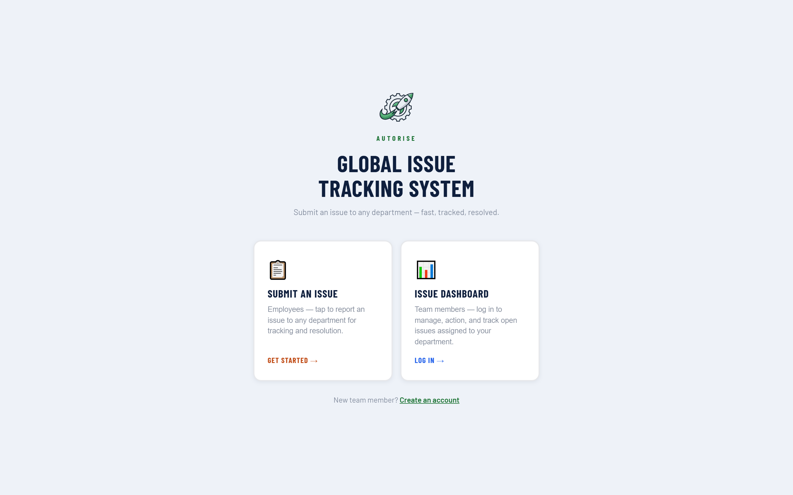
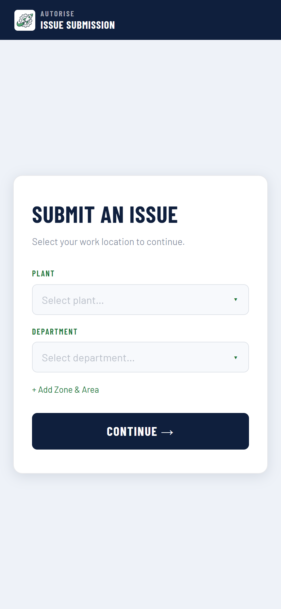
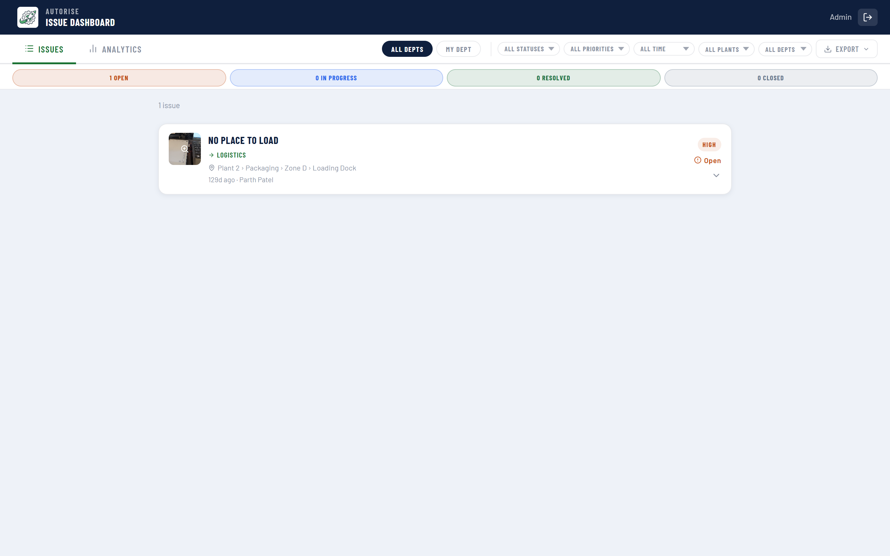

# GITS — Global Issue Tracking System

*Snapshot of my private repository (15 commits, Apr to Aug 2026), published Aug 2026 as a code sample. It contains no client data or secrets.*

**Cross-department issue routing with a full audit trail.**

[**Live demo →**](https://gits.autoriseconsulting.com/autorise) · part of a multi-tenant suite built for small and mid-market operations teams

---

## The problem

When one department raises an issue against another, it usually lives in an email thread.
There is no owner, no status, no history, and no way to measure how long anything takes. The
thread becomes the system of record, and it is invisible to everyone not on it.

## What it does

- **Receiving-department routing** — an issue is raised *against* a department, which is what makes it cross-functional rather than a personal to-do
- **Four statuses and four priorities** with visible state, so what needs attention reads at a glance
- **Tasks per issue** — a checklist under each issue so resolution is broken into owned steps
- **Append-only comments** — an audit trail rather than an editable description, because accountability requires history
- **Notification badge** — unseen-count per department computed against a stored last-seen marker
- **Average resolution time** in analytics — the metric that tells you whether the process is actually improving
- **PDF and CSV export**

## Screenshots

### Landing — raise or review



### Issue capture (mobile)



### Issue dashboard



## Stack

React 19 · Vite 8 · Supabase (PostgreSQL + Realtime + Storage) · Recharts · CSS Modules · Cloudflare Pages

## Architecture

Every tenant is isolated by `company_id` with the company `slug` carried in the URL, so a
single deployment serves any number of organisations without a per-client build.

```
Browser (React 19 + Vite)
   |
   |-- anon key, governed by Row Level Security
   v
Supabase
   +-- PostgreSQL   tenant-scoped tables, RLS policies per company
   +-- Realtime     dashboards update without polling
   +-- Storage      photo uploads on a public read bucket
```

**Design decisions worth calling out**

- **Tenant resolution from the URL.** `/:companySlug` resolves the company once and hydrates
  branding, location vocabulary and feature flags from a single row. Adding a client is a
  database insert, not a deployment.
- **Branding is data, not code.** Logo and brand colours live on the company record. A
  `ensureContrast()` helper darkens any supplied brand colour until it clears WCAG AA (4.5:1)
  against its background, so a client with a pale yellow brand still gets readable UI.
- **Configurable location vocabulary.** One plant calls it Plant / Department / Zone / Line,
  another calls it Site / Area / Cell / Station. Labels and option lists are stored per company
  in JSONB rather than hardcoded.
- **The anon key is the only credential in the browser.** All privileged operations are either
  RLS-permitted or handled server-side. A service-role key is never given a `VITE_` prefix,
  because Vite inlines every `VITE_*` variable it finds referenced in client source, which
  would publish the key inside the JS bundle.
- **Realtime over polling.** Supervisor dashboards subscribe to Postgres changes, so a
  submission from the floor appears without a refresh.

## Running it locally

```bash
npm install
cp .env.example .env.local   # add your own Supabase project URL + anon key
npm run dev
```

Apply the SQL in `supabase/` to your own project first, then visit `/your-company-slug`.
The schema builds on the `companies` and `managers` tables shared with SRTS and SHRS, which
this repo does not create.

```bash
npm run build     # production build
```

Deployed on Cloudflare Pages. `public/_redirects` contains the SPA fallback
(`/* /index.html 200`) so client-side routes survive a hard refresh.

## Notes

This is a portfolio copy of a system running in production. Operational provisioning
scripts and all client data are excluded; the application code, database schema and
architecture are intact.

Built by [Parth Patel](https://www.linkedin.com/in/parth-patel-83273a28a) — AutoRise LLC.
